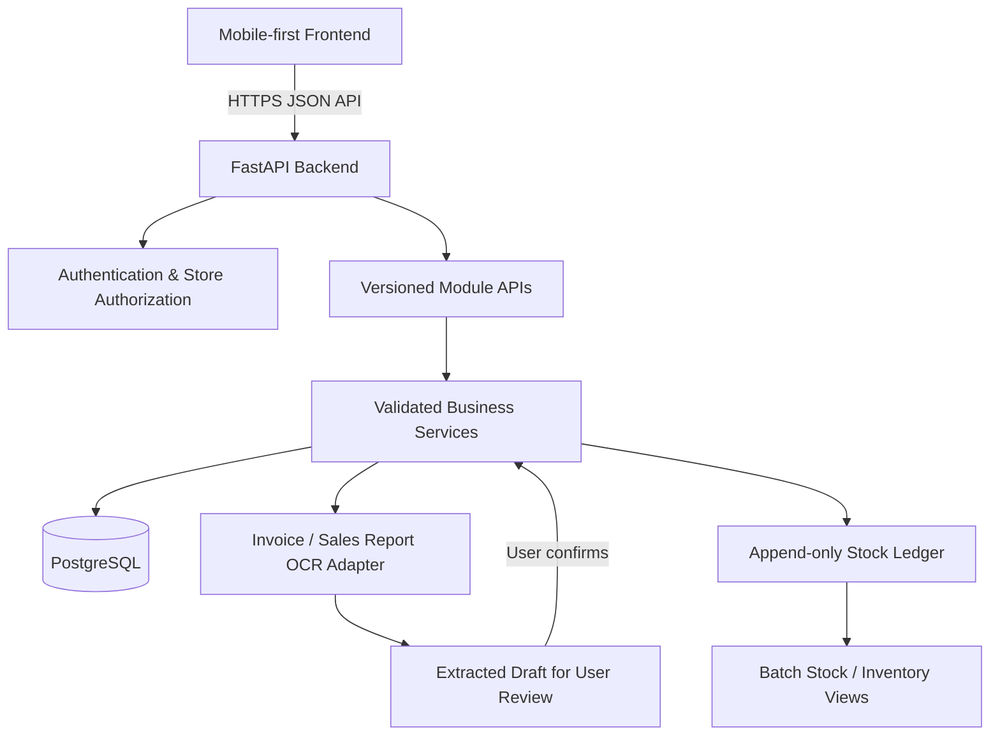

# Architecture

## Boundaries
- Frontend communicates with FastAPI; it never connects directly to PostgreSQL.
- API routers validate transport requests; business services enforce rules; database code handles persistence.
- OCR output is untrusted draft data. It does not mutate inventory until reviewed and explicitly confirmed.
- The inventory ledger is the stock movement history. A cached/current balance may be maintained, but it must remain consistent with the ledger.
- External integrations (OCR, WhatsApp, reminders) should sit behind adapters so provider changes do not leak through module code.

## Database
PostgreSQL, accessed by the backend with `asyncpg`. All schema changes are versioned
Alembic migrations in `backend/alembic/` — never hand-edit a shared database. Run
`alembic upgrade head` before starting the backend against a fresh database.

## Module data boundaries
Each module owns its own tables and exposes its data to other modules through
service functions or read-only views. Modules must never query another module's
tables directly, so schema refactors stay contained to their owner.
